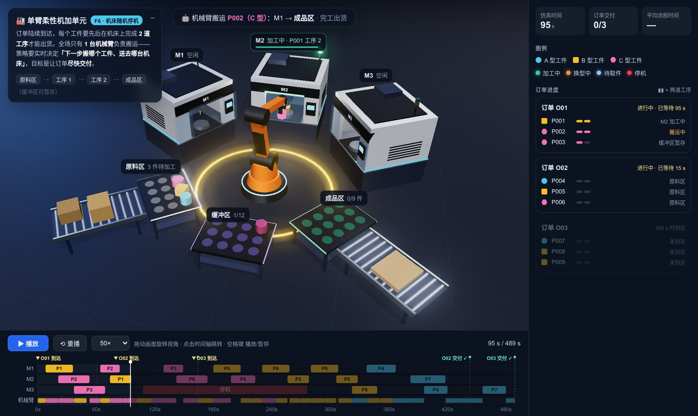
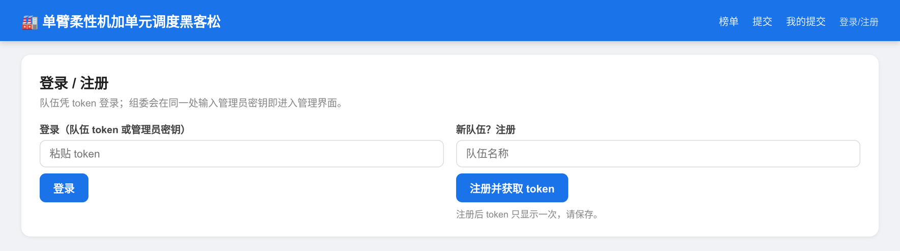
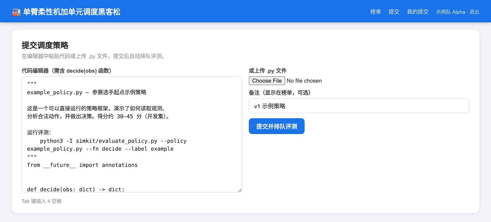
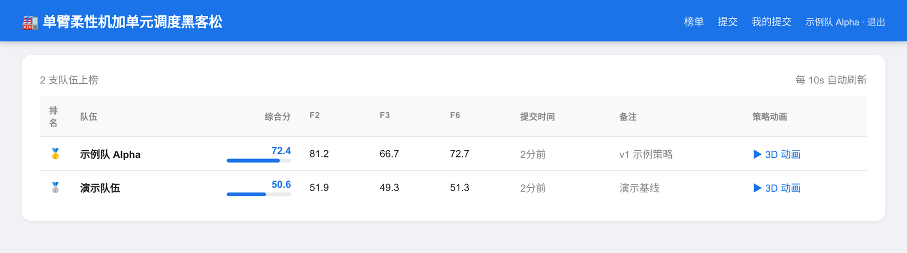
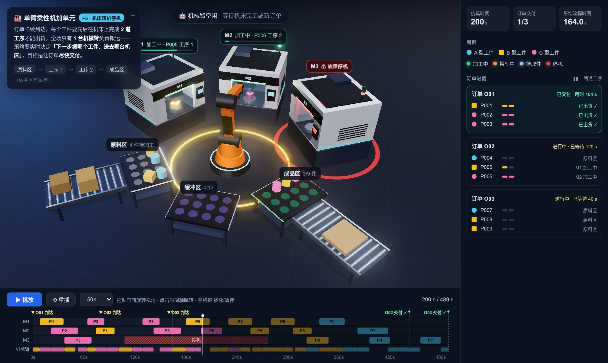

<div class="cover">
<div class="kicker">HACKATHON · 参赛指南</div>
<h1 class="title">单臂柔性机加单元调度</h1>
<p class="sub">从下载参赛包到提交上榜，照着这份文档做就行，全程大约 15 分钟。</p>
<table class="facts">
<tr><td>比赛网站</td><td><a href="https://hackathon.turing-zero.com">https://hackathon.turing-zero.com</a></td></tr>
<tr><td>参赛包下载</td><td><a href="https://github.com/Mark-tz/hackathon/releases">https://github.com/Mark-tz/hackathon/releases</a></td></tr>
<tr><td>你需要准备</td><td>一台装了 Python 3.10 或更高版本的电脑，不需要安装任何第三方库</td></tr>
<tr><td>你要提交</td><td>一个 <code>.py</code> 文件，里面有一个 <code>decide(obs)</code> 函数</td></tr>
</table>
</div>

## 1. 这道题在做什么

一个小型加工车间里有 **3 台机床**（M1、M2、M3）和 **1 台机械臂**。订单陆续到达，每个订单包含若干工件，每个工件要先后在机床上完成 **2 道工序**才能出货。所有搬运都靠这一台机械臂完成。

你写的程序就是这台机械臂的大脑：每当它空下来，程序要决定**下一步搬哪个工件、送到哪台机床**。目标是让订单尽快交付，也就是**订单平均流程时间越短越好**（流程时间 = 订单最后一个工件出货的时刻 − 订单到达的时刻）。

下图是比赛网站上的 3D 策略动画，每一次提交都会自动生成一份：



图里的对应关系：

| 画面元素 | 含义 |
|---|---|
| 中间的橙色机械臂 | 全场唯一的搬运设备，你的策略控制它 |
| 三台机床 M1 / M2 / M3 | 加工工件；不同机床做同一道工序的速度不同 |
| 原料区、缓冲区、成品区 | 工件从原料区进场，可在缓冲区暂存，两道工序做完后送成品区 |
| 右侧「订单进度」 | 每个工件的两道工序完成情况 |
| 底部时间轴 | 每台机床和机械臂在各时刻做什么；红色斜纹段是机床停机 |

题目的难点来自三件事：同一道工序可以选不同机床（快慢不同）；机床换加工另一种工件时可能要花时间换型；机床可能突然停机。完整规则见参赛包里的 `problem/赛题说明.md`。

## 2. 五步上手

1. 从 GitHub Release 下载参赛包并解压（第 3 节）。
2. 在本地跑通示例策略，看到分数（第 4 节）。
3. 写自己的 `decide(obs)`，在本地评测（第 5 节）。
4. 打开比赛网站，注册队伍，保存 token（第 6 节）。
5. 在网站提交策略文件，查看分数、榜单和 3D 动画（第 6 节）。

## 3. 获取参赛包

打开 <https://github.com/Mark-tz/hackathon/releases>，在最新一个 Release 的 **Assets** 里下载 `hackathon_participant.zip`，解压后进入目录：

```bash
unzip hackathon_participant.zip
cd hackerson
```

目录内容：

| 文件 | 用途 |
|---|---|
| `README.md` | 快速上手（本指南的精简版） |
| `problem/赛题说明.md` | 完整赛题：规则、接口、评分，**建议通读一遍** |
| `example_policy.py` | 示例策略，可以直接在它上面改 |
| `simkit/evaluate_policy.py` | 本地评测脚本，输出和网站一致的分数构成 |
| `simkit/visualize.py` | 生成甘特图 HTML |
| `simkit/visualize_3d.py` | 生成和网站一样的 3D 动画 HTML |
| `simkit/engine.py` | 仿真引擎，可以在自己的策略里调用 |

## 4. 在本地跑通

先确认 Python 版本（需要 3.10 或更高）：

```bash
python3 --version
```

评测示例策略：

```bash
python3 -I simkit/evaluate_policy.py --policy example_policy.py --fn decide --label example
```

Windows 上如果没有 `python3` 命令，把 `python3` 换成 `python`。

输出的最后几行是这样的：

```text
  F3:   55.67  ([50.1, 60.37, 56.53])
  F6:   63.70  ([66.58, 53.18, 71.33])

  总均分       :   68.37
  最差两族均分 :   59.68
  组合分(0.7+0.3):   65.76
```

**组合分**就是排名用的分数。F2、F3、F6 是三类场景（各 3 个实例），含义见第 7 节。

想看策略实际跑起来的样子，生成一份 3D 动画，用浏览器打开 `result_3d.html`（需要联网）：

```bash
python3 -I simkit/visualize_3d.py --instance dev-F6-301 --policy example_policy.py --out result_3d.html
```

## 5. 编写你的策略

### 5.1 最小可运行策略

新建 `my_policy.py`，写入：

```python
def decide(obs):
    # 永远选第一个合法动作。能跑，但分数不高。
    return obs["legal_actions"][0]
```

本地评测：

```bash
python3 -I simkit/evaluate_policy.py --policy my_policy.py --fn decide --label v1
```

### 5.2 接口约定

每当需要做决定时，评测器调用一次 `decide(obs)`。你从 `obs["legal_actions"]` 里**挑一个动作原样返回**。

`obs` 里的主要字段：

| 字段 | 内容 |
|---|---|
| `t_ms` | 当前仿真时刻，单位毫秒 |
| `robot` | 机械臂位置和状态，例如 `{"pos": "M1", "holding": null, "state": "IDLE"}` |
| `machines` | 每台机床的状态（`IDLE` / `PROCESSING` 等）、当前工件、上次加工的工件类型 `setup_from`、停机恢复时刻 `down_until` |
| `buffer` | 缓冲区里的工件 ID 列表 |
| `parts` | 每个工件的类型、下一道工序 `next_op`、位置 `location`、是否已加工完等待取走 `on_machine_done` |
| `orders` | 每个订单的到达时刻、已完成工件数、总工件数 |
| `legal_actions` | 当前所有合法动作，**只能从这里选** |

动作只有两种：

```json
{"action_id": 2, "kind": "move", "part": "P003", "from": "BUF", "to": "M1",
 "nominal_ms": 28000, "setup_ms": 40000, "machine_setup_from": "B"}
{"action_id": 3, "kind": "wait"}
```

`move` 表示把某个工件从一处搬到另一处。送往机床时，`nominal_ms` 是加工时间，`setup_ms` 是换型时间，都已经替你算好。`wait` 表示什么都不做，等到下一个事件发生。

### 5.3 示例策略的思路

参赛包里的 `example_policy.py` 用了一组简单的优先级规则，核心部分如下：

```python
def decide(obs):
    acts  = obs["legal_actions"]
    parts = obs["parts"]
    wait  = next(a for a in acts if a["kind"] == "wait")
    moves = [a for a in acts if a["kind"] == "move"]
    if not moves:
        return wait

    # 1. 先把加工完的工件从机床上取走，免得机床被占着
    unload = [a for a in moves if parts.get(a["part"], {}).get("on_machine_done")]
    if unload:
        to_out = [a for a in unload if a["to"] == "OUT"]
        return to_out[0] if to_out else unload[0]

    # 2. 能出货的直接送成品区
    to_out = [a for a in moves if a["to"] == "OUT"]
    if to_out:
        return to_out[0]

    # 3. 送机床加工：选「换型时间 + 加工时间」最小的
    to_machine = [a for a in moves if a["to"] not in ("OUT", "BUF")]
    if to_machine:
        return min(to_machine, key=lambda a: a.get("setup_ms", 0) + a.get("nominal_ms", 0))

    return wait
```

### 5.4 三条必须遵守的规则

- **只能返回 `legal_actions` 里的动作。** 返回其他内容，这一局直接记 −100 分。
- **不要抛异常，不要死循环。** 策略崩溃同样记 −100 分；超时则整次提交判为失败。
- **只用 Python 标准库。** 评测机上没有 numpy 等第三方库。

### 5.5 往哪个方向提分

- 示例策略只看眼前一步。可以调用 `simkit/engine.py` 做前瞻：对每个候选动作往后模拟一段，选结果最好的那个。引擎是确定性的，单局模拟不到 1 毫秒。
- 换型时间长的场景（F3），把同类工件攒在一起加工往往更划算。
- 有停机的场景（F6），留意 `down_until`，及时把工件改送到备用机床。
- 总分里最差的两类场景占了额外权重，只优化一类场景拿不到高分。

## 6. 在比赛网站提交 {.pb}

网站地址：<https://hackathon.turing-zero.com>

### 6.1 注册队伍

点右上角「登录/注册」，在右侧「新队伍？注册」里填队伍名称，点「注册并获取 token」。



<div class="warn">
<b>token 只显示一次，请立刻复制保存。</b>它是你们队伍的唯一登录凭证，全队共用。之后在任何电脑上，把 token 粘贴到左侧「登录」框即可登录。token 丢失后请联系组委会。
</div>

### 6.2 提交策略

登录后点顶部「提交」。把整个策略文件的内容粘贴进代码编辑器，或者用右边的「上传 .py 文件」选择文件。备注可以写版本说明（会显示在榜单上），然后点「提交并排队评测」。



### 6.3 查看结果

提交后进入「我的提交」，状态会依次变为 **排队中 → 评测中 → 完成**，通常几秒到一分钟。如果状态是 **错误**，同一行会显示错误信息，按提示修改后重新提交。


### 6.4 榜单和 3D 动画

「榜单」页按每支队伍的**历史最高分**排名，所以提交一个更差的版本不会让排名下降。



每条完成的提交后面都有「▶ 3D 动画」，点开就能看到这份策略在一个停机场景（F6）里的完整执行过程。动画默认以 50 倍速自动播放，可以拖动画面旋转视角，点击底部时间轴跳到任意时刻，按空格键暂停。榜单上其他队伍的动画也可以看（只公开动画，不公开代码）。



## 7. 评分方式

每个实例的得分：

```text
得分 = 100 × (C_base − 你的平均流程时间) / (C_base − C_ref)
```

`C_base` 是一个故意做得很差的基线（对应 0 分），`C_ref` 是三个简单规则基线中最好成绩的 80%（对应 100 分）。比参照更好可以超过 100 分，最低 −100 分。没完成的订单按整局时长计入流程时间，会扣分但不会直接判负。

三类场景：

| 场景 | 特点 |
|---|---|
| F2 · 单机瓶颈 | 多数工件第一道工序只有 M1 做得快，M1 不能闲着 |
| F3 · 高换型 | 机床换加工另一种工件要 35–40 秒，和加工时间差不多 |
| F6 · 扰动 | 有一台机床会停机 120–200 秒 |

排名用的组合分：

```text
组合分 = 0.7 × 三类场景得分的平均 + 0.3 × 最差两类场景得分的平均
```

分数的大致水平：

| 策略类型 | 典型组合分 |
|---|---|
| 随机或有错误的策略 | 低于 0 |
| 简单规则 | 55 – 70 |
| 带前瞻搜索并反复迭代 | 65 – 90 |

<div class="note">
网站评测用的实例和参赛包里的开发集（<code>dev-F2-101</code> 等）类型相同，但随机种子不同。所以本地分数和网站分数会有几分的差别，这是正常的；只在开发集上反复调参得到的提升，到网站上可能会缩水。
</div>

## 8. 提交限制

| 项目 | 限制 |
|---|---|
| 提交频率 | 每支队伍每 5 分钟最多 1 次 |
| 文件 | 单个 `.py` 文件，UTF-8 编码，不超过 64 KB |
| 入口 | 文件里必须有 `decide(obs)` 函数 |
| 运行时间 | 一次提交的全部评测合计不超过 120 秒 CPU 时间 |
| 内存 | 512 MB |
| 依赖 | 仅 Python 标准库 |

建议把单次决策控制在 1 秒以内，单个实例累计 20 秒以内（赛题说明第 10 节的正式限额）。

## 9. 常见问题

**提交后一直显示「排队中」。** 评测是一份一份串行进行的，前面有人排队时需要等一会儿。超过 10 分钟没有变化，请联系组委会。

**状态显示「错误」。** 看同一行的错误信息。最常见的原因：文件里没有 `decide` 函数、代码有语法错误、用了第三方库、运行超时。先在本地用第 4 节的评测命令跑通再提交。

**分数是 −100 或远低于本地。** 说明有实例被判无效：返回了不在 `legal_actions` 里的动作，或者策略在某种情况下抛了异常。

**提示「提交过于频繁」。** 距上次提交不足 5 分钟，等一下再试。先在本地评测，把网站提交留给确实有改进的版本。

**3D 动画打不开或一直在加载。** 动画页面需要从公共 CDN（`cdn.jsdelivr.net`）加载 3D 库，请检查网络后刷新。

**可以用 AI 工具写代码吗？** 可以，赛题本身就鼓励用 AI 加自动迭代来优化策略。

**最终还要交什么？** 除了策略源码，赛题说明第 11 节还要求提交迭代记录 `evolution/lineage.jsonl` 和分析文档 `ANALYSIS.md`，格式见该节，提交方式以组委会通知为准。
